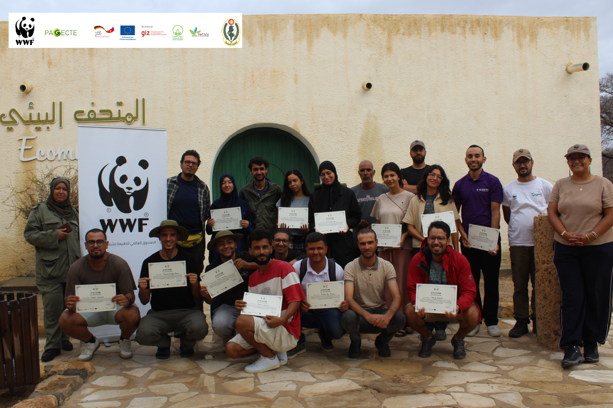

# WWF Talent Academy 2026 — Base de Données Géospatiale et Écologique du Parc National de Bouhedma
**Bouhedma National Park Geospatial and Biodiversity Monitoring Database**



[](https://creativecommons.org/licenses/by-nc-sa/4.0/)
[-blue.svg)](https://epsg.io/4326)
[](https://www.protectedplanet.net/13962)
[](https://en.unesco.org/mab)

---

## 🇫🇷 Présentation du Projet (Français)

Cette base de données géospatiale compile l'ensemble des données géographiques, écologiques et méthodologiques collectées lors du camp de terrain **WWF Talent Academy 2026** (Session Savane, 14–19 septembre 2026) au **Parc National de Bouhedma** (Tunisie centrale), enrichie du réseau de suivi bioacoustique passif (**PAM / GeoAI**) pour le déploiement d'enregistreurs Song Meter Micro 2 / AudioMoth.

Le Parc National de Bouhedma protège l'unique savane pré-saharienne d'Afrique du Nord dominée par ***Vachellia tortilis*** (anciennement *Acacia raddiana*) et constitue un pôle de référence pour la réintroduction et le suivi de la grande faune saharo-sahélienne :
* **Oryx algazelle** (*Oryx dammah* - Code WWF : `ORDA`, Statut UICN : Éteint à l'état sauvage / Réintroduit)
* **Gazelle dorcas** (*Gazella dorcas* - Code WWF : `GADO`, Statut UICN : Vulnérable)
* **Mouflon à manchettes** (*Ammotragus lervia* - Code WWF : `AMLE`, Statut UICN : Vulnérable)
* **Autruche d'Afrique du Nord** (*Struthio camelus* - Code WWF : `STCA`, Réintroduite en enclos)
* **Faune carnivore & nocturne** : Hyène rayée (*Hyaena hyaena*), Loup doré (*Canis lupaster* / *aureus*), Renard roux (*Vulpes vulpes*).

---

## 🇬🇧 Project Overview (English)

This geospatial database compiles all geographic, ecological, and methodological monitoring data collected during the **WWF Talent Academy 2026** field camp (Savanna Session, September 14–19, 2026) in **Bouhedma National Park** (Central Tunisia), expanded with the Passive Acoustic Monitoring (**PAM / GeoAI**) network design for deploying 20 autonomous bioacoustic recorders.

Bouhedma National Park preserves North Africa's last remaining pre-Saharan savanna dominated by ***Vachellia tortilis*** (formerly *Acacia raddiana*) and serves as the flagship reintroduction center for threatened Saharan megafauna (Scimitar-horned Oryx, Dorcas Gazelle, Barbary Sheep, and North African Ostrich).

---

## 👥 Encadrement Scientifique & Experts de Session / Scientific Leadership

| Thématique / Session | Encadrant(s) Scientifique(s) | Institution de rattachement |
| :--- | :--- | :--- |
| **Grands Herbivores & Recensement (J2)** | **Marie Petretto** | Marwell Wildlife |
| **Chiroptères / Chauves-souris (J2)** | **Khaled Ferchichi** | Helmholtz Institute for One Health (HIOH) |
| **Carnivores & Pièges Photographiques (J3)** | **Dr. Haithem El-Farhati & Jamel Jrijer** | WWF Afrique du Nord & Conservation du Parc |
| **Entomologie Nocturne (J3)** | **Wael Ben Aba** | WWF Afrique du Nord |
| **Micro-mammifères, Rongeurs & Transects (J4)**| **Faouz Kilani & Dr. Haithem El-Farhati** | WWF Talent Academy & Experts associés |
| **Phytoécologie & Dendrométrie (J5)** | **Dr. Alaeddine Rouissi** | WWF Afrique du Nord & Enseignant-chercheur |
| **Bioacoustique (PAM) & Modélisation GeoAI** | **Équipe WILDLABS / WWF Talent Academy** | WWF Afrique du Nord & Partenaires |
| **Coordination Générale & Données** | **Zakher Bouragaoui & Intissar Ferjani** | WWF Afrique du Nord |

---

## 🗃️ GeoPackage Maître : `bouhedma_database.gpkg` (29 Couches)

Le fichier unifié `bouhedma_database.gpkg` rassemble les **29 couches vectorielles officielles** du projet sous le SCR **WGS 84 (EPSG:4326)** :

### 1. Délimitation, Zonage & Infrastructures de Conservation (6 couches)
- `PARC_NATIONAL_BOUHEDMA_SECTOR1` : Polygone officiel du Secteur 1 (cœur de conservation clôturé).
- `CAMP_WWF` : Camp de base logistique des chercheurs et éco-gardes.
- `CHATEAU_FRANCAIS_BOUHEDMA` : Poste historique et réservoir d'eau.
- `ECO_PARC_BOUHEDMA` : Écomusée et centre d'accueil pédagogique.
- `ENCLOS_AUTRICHE` : Enclos de reproduction conservatoire des Autruches d'Afrique du Nord.
- `ENCLOS_MOUFLAND` : Enclos d'acclimatation des Mouflons à manchettes.

### 2. Jour 2 — Chiroptères & Recensement des Herbivores (4 couches)
- `BAT_NET_DAY2` : Emplacement du filet japonais (capture non létale des chauves-souris).
- `GPS1_SPECIES_OBSERVATION_DAY2` : Relevés faunistiques directs (Oryx, Gazelles dorcas).
- `GPS5_SPECIES_OBSERVATIONS_DAY2` : Observations complémentaires de troupeaux d'herbivores.
- `GPS4_TRAIL_OBSERVATION_DAY2` : Sentier de patrouille pédestre (sentier de marche, zéro bruit moteur).

### 3. Jour 3 — Carnivores & Entomologie Nocturne (4 couches)
- `CAMERA_TRAPS_DAY3` : Stations de pièges photographiques infrarouges (suivi carnivores).
- `INSECT_OBSERVATION_DAY3` : Station lumineuse entomologique nocturne sur drap blanc.
- `ITINERARY_CAMERA_TRAP_DAY3` : Itinéraire pédestre de pose des pièges photo.
- `GPS6_TRAIL_OBSERVATION_DAY3` : Sentier de suivi faune pédestre Jour 3.

### 4. Jour 4 — Micro-mammifères & Transects Bio-index (3 couches)
- `RODENT_CAGE_DAY4` : Ligne de cages pièges de capture vivante de rongeurs désertiques.
- `TRANSECT_ANIMALS_BIO_INDEX_DAY4` : Tracé linéaire du transect synchronisé à 3 observateurs.
- `TRANSECT_ANIMALS_BIO_INDEX_POINTS_DAY4` : Points de départ et d'arrivée du transect.

### 5. Jour 5 — Phytoécologie & Dendrométrie (7 couches)
- `AIN_CHARCHARA_DAY5` : Source pérenne et cascade dans les gorges rocheuses.
- `GROUP1_PLANT_OBSERVATION_DAY5` : Relevés floristiques et dendrométriques Groupe 1 (*Vachellia tortilis*).
- `GROUP2_PLANT_OBSERVATION_DAY5` : Relevés floristiques Groupe 2.
- `GROUP3_PLANT_OBSERVATION_DAY5` : Relevés floristiques Groupe 3.
- `ITINERARY_AIN_CHARCHARA_DAY5` : Trace GPS de l'excursion vers les gorges d'Aïn Charchara.
- `PLAN_TRANSECT_DAY5` : Ligne directrice du transect phytoécologique.
- `TRANSECT_PLANT_OBSERVATION_DAY5` : Quadrats emboîtés et mesures dendrométriques.

### 6. Réseaux Routiers & Lignes Électriques OSM (2 couches)
- `ROADS_PARC_NATIONAL_BOUHEDMA` : Réseau routier OSM (Route Régionale asphaltée RR124 au sud, pistes internes `service` et `track`).
- `POWERLINES_PARC_NATIONAL_BOUHEDMA` : 197 pylônes électriques OSM (dont 15 dans le Secteur 1 servant de perchoirs d'affût aux rapaces).

### 7. Réseau de Monitoring Bioacoustique Passif (PAM / GeoAI) (3 couches)
- `BOUHEDMA_PAM_FINAL_SITES` : **Les 20 stations d'enregistrement bioacoustique passif** optimisées par algorithme d'inhibition spatiale Matérn Type II (supports : houppiers d'acacias et pylônes électriques perchoirs).
- `REAL_WATER_SOURCES` : **Les 10 sources d'eau réelles et pérennes validées sur le terrain** (Aïn Charchara, Cirque Nord, Camp WWF, Château, Éco-Parc, Enclos faune, Gueltas).
- `ROAD_EXCLUSION_BUFFER` : Zone tampon de quiétude acoustique (300 m d'exclusion stricte le long de la route asphaltée RR124 au sud).

---

## 📁 Structure du Répertoire / Directory Structure

```
WWF_TALENT_ACADEMY_2026_BOUHEDMA_DATABASE/
├── bouhedma_database.gpkg      # BASE MAÎTRE OFFICIELLE (29 couches vectorielles en WGS 84)
├── DAY1_14-09-2026/            # Infrastructures, Zonage WDPA 13962 & Réseaux OSM
├── DAY2_15-09-2026/            # Sentier pédestre GPS4, Recensement antilopes & Chiroptères
├── DAY3_16-09-2026/            # Sentier pédestre GPS6, Pièges photo & Entomologie nocturne
├── DAY4_17-09-2026/            # Cages rongeurs & Transect bio-index 3 observateurs
├── DAY5_18-09-2026/            # Phytoécologie, Dendrométrie Vachellia tortilis & Aïn Charchara
├── PAM_BIOACOUSTIQUE_BOUHEDMA/ # DOSSIER COMPLET DU RÉSEAU PAM (Scripts, Raster, Vecteurs, Tables, QML)
│   ├── scripts/                # 01_gee_stack.js, 02_geoai_tree_and_water_detector.py
│   ├── data/gee_stack/         # bouhedma_stack_10m.tif (Sentinel-2 / SRTM 10m)
│   ├── data/outputs_vectors/   # 20 sites PAM (GeoJSON UTM/WGS), 10 sources d'eau, buffer RR124
│   ├── data/outputs_tables/    # candidate_sites_field_sheet.csv, parameters.csv, species_guilds.csv
│   ├── project/qml_styles/     # Styles QGIS officiels (PAM sites, sources d'eau, exclusion)
│   └── references/             # METHODOLOGY_EXPLANATION.md, README_RECORDERS.md
├── Ressources_en_francais/     # Fiches officielles (PDF, Word, Excel, Markdown)
└── Resources_in_English/       # Official Documentation (PDF, Word, Excel, Markdown)
```

---

## 📚 Documentation Officielle & Tables d'Attributs (Bilingue)

Les dossiers `Ressources_en_francais/` et `Resources_in_English/` contiennent chacun les 4 documents normatifs dans tous les formats éditables et imprimables :

| Document | Formats disponibles | Norme / Standard |
| :--- | :--- | :--- |
| **Fiche Descriptive des Métadonnées** | `.pdf` (A4 Portrait), `.docx`, `.md` | UNEP-WCMC WDPA Version 1.6 & ISO 19115 |
| **Table Synthétique des Attributs** | `.pdf` (A4 Paysage), `.xlsx`, `.docx`, `.md` | Dictionnaire de données BHD26-COM-CODE (7 sections) |

---

## 🌐 Système de Coordonnées & Précision / Spatial Reference System

* **CRS / Système de référence :** WGS 84 (World Geodetic System 1984)
* **Code EPSG :** `EPSG:4326`
* **Projection métrique recommandée pour l'analyse SIG :** WGS 84 / UTM Zone 32N (`EPSG:32632`)
* **Unités de la base maître :** Degrés décimaux (Latitude / Longitude)
* **Emprise Bounding Box :**
  * Ouest (Min X) : `9.2622° E`
  * Est (Max X) : `9.6850° E`
  * Sud (Min Y) : `34.2855° N`
  * Nord (Max Y) : `34.6105° N`

---

## 📜 Licences & Droits d'Utilisation / License

* **Données géospatiales & métadonnées :** [Creative Commons Attribution - Pas d’Utilisation Commerciale - Partage dans les Mêmes Conditions 4.0 International (CC BY-NC-SA 4.0)](https://creativecommons.org/licenses/by-nc-sa/4.0/).
* **Code source & scripts de traitement :** [MIT License](https://opensource.org/licenses/MIT).

---

## 📖 Citation Recommandée / How to Cite

```bibtex
@dataset{wwf_bouhedma_2026,
  author       = {{WWF Afrique du Nord} and {Direction Générale des Forêts}},
  title        = {Base de données géospatiale et écologique du Parc National de Bouhedma – WWF Talent Academy 2026},
  year         = {2026},
  publisher    = {WWF North Africa},
  address      = {Tunis, Tunisie},
  url          = {https://www.wwfna.org}
}
```
